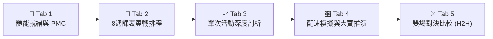
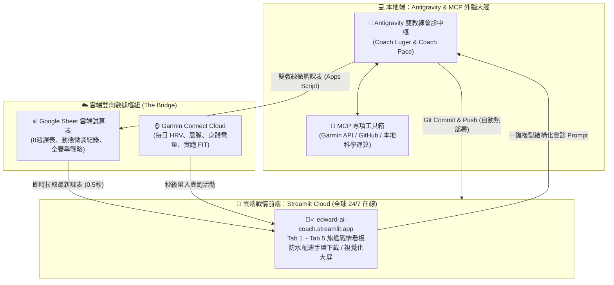

# 🏃 AI Coach 運動科學戰情看板 (Sports Science Dashboard)

[](https://edward-ai-coach.streamlit.app/)
[](https://www.python.org/)
[](https://opensource.org/licenses/MIT)

> 一套專為長跑與馬拉松跑者打造的**高階運動科學戰情儀表板**。  
> 整合 Garmin Connect 雲端極速同步、Coggan 經典體能負荷管理 (PMC)、8 週實戰課表 Google Sheet 雙向連動、每公里動力學深度剖析，以及客製化賽事防水配速手環！

🌐 **全球雲端 24/7 線上即時體驗：**  
👉 **[https://edward-ai-coach.streamlit.app/](https://edward-ai-coach.streamlit.app/)**

---

## 🌟 五大核心戰情分頁 (Core Features)



### 1. 🔋 體能就緒與 PMC 負荷管理 (Tab 1)
* **每日晨檢就緒度**：連動 Garmin 手錶自律神經 HRV、晨脈、身體電量 (Body Battery) 與睡眠品質，精準評估今日訓練容量。
* **Coggan 體能管理中樞**：自動推演 42 天體能累積 (CTL)、7 天短期疲勞 (ATL) 與比賽狀態指標 (TSB)，精準掌控大賽超量補償與巔峰期。

### 2. 📅 8 週課表實戰排程與執行中樞 (Tab 2)
* **大賽實戰課表**：針對賽事週期設計週二（耐坡/排酸）、週四（節奏/步頻衝刺）、週日（平地河堤長距離 LSD）三堂關鍵課。
* **執行吻合度比對**：自動比對手錶實跑數據與目標配速、心率防線之吻合度。
* **雙教練一鍵提問**：自動組裝結構化提問 Prompt，一鍵複製發起 Antigravity 雙教練臨床會診。
* **Google Sheet 雙向同步**：支援一鍵 `🔄 刷新雲端課表`，試算表改動 0.5 秒即時反映，斷網自動無縫切換本地備份。

### 3. 📈 單次活動深度剖析 (Tab 3)
* **多層級同步折線**：配速逆向走勢、心率區間漂移、步頻與垂直振幅動態聯動。
* **每公里力學指標拆解**：觸地時間 (GCT)、左右平衡、步幅、垂直振幅比與跑步能效 (EF)。
* **🕸️ 步態力學五維雷達天平**：將當前活動與個人歷史 PB 巔峰進行五維（節奏、剛性、步幅、垂直效率、心肺能效）量化評分。
* **🩺 雙教練臨床會診**：路格 (Luger) 生理心率成因解剖 ＋ 佩絲 (Pace) 步態力學與配速處方。

### 4. 🎛️ 配速模擬與大賽沙盤推演 (Tab 4)
* **四大科學配速策略**：等速巡航 (Even Split)、前慢後快 (Negative Split)、梯形穩進、抗撞牆保留配速。
* **專項模式切換**：支援間歇跑、節奏跑、LSD 穩態跑與全馬大賽沙盤推演。
* **氣候溫濕度補償**：根據賽日預估氣溫動態修正脫水率與體能折損。
* **防水配速手環下載**：高解析度自動繪製，標註 LTHR 防線與各段補給水站，一鍵下載列印直接戴上賽道。

### 5. ⚔️ 雙場對決比較 Head-to-Head (Tab 5)
* **核心量化天平**：PB 巔峰場次 vs 最新實戰的 11 項關鍵戰力指標全盤對決 (Tale of the Tape)。
* **貫穿式多軸同步走勢圖**：全圖啟用貫穿 3 個子圖表的**垂直紅色指針輔助線**，游標左右滑動時即時同步比對兩場比賽同公里的配速、心率與觸地剛性。
* **跑姿退化指數歸一化**：對比兩場比賽在後半程 15～21K 疲勞期的步態剛性頑強程度。

---

## 🚀 3 分鐘一鍵雲端部署 (免費 24/7 在線)

任何人都可以輕鬆複製並在 Streamlit Cloud 上免費發布屬於自己的戰情平台：

### 步驟 1：Fork 儲存庫
點擊本頁面右上角的 **「Fork」**，將專案複製到您的 GitHub 帳號。

### 步驟 2：在 Streamlit Cloud 發布
1. 前往 👉 [https://share.streamlit.io/](https://share.streamlit.io/) 並以 GitHub 帳號登入。
2. 點擊 **「New app」**，設定如下：
   * **Repository**：選擇 `您的帳號/ai-coach`
   * **Branch**：`main`
   * **Main file path**：`app.py`
3. 點擊 **「Advanced settings -> Secrets」**，依照 `keys.example.json` 貼入您的金鑰（若暫時無金鑰可先留空，不影響手動上傳分析與配速手環功能）：
   ```toml
   GARMIN_PERSONAL_API_KEY = "您的Garmin_Token"
   GOOGLE_SHEET_WEBHOOK_URL = "您的Google_Apps_Script_URL"
   GOOGLE_SHEET_URL = "您的Google_Sheet_瀏覽網址(選填)"
   GOOGLE_SHEET_CSV_URL = "您的Google_Sheet_CSV匯出網址(選填)"
   ```
4. 點擊 **「Deploy」**，約 1～2 分鐘後即可獲得專屬公開網址！

---

## 💻 本地端運行指南 (Local Setup)

```powershell
# 1. 複製專案
git clone https://github.com/rledward1-code/ai-coach.git
cd ai-coach

# 2. 建立虛擬環境並安裝依賴
python -m venv venv
.\venv\Scripts\activate
pip install -r requirements.txt

# 3. 配置金鑰 (複製範本並填寫)
copy keys.example.json keys.json

# 4. 啟動戰情看板
streamlit run app.py
```

### Windows 開機靜默自啟動（零黑視窗背景運行）
專案內建專屬靜默啟動器：
```powershell
python setup_autostart.py
```
執行後會自動在「Windows 開機啟動」與「桌面」建立捷徑，開機自動背景載入並自動喚起預設瀏覽器！若要解除自啟動，執行 `python setup_autostart.py remove` 即可。

---

## 🔒 隱私與安全機制

* **個人金鑰徹底隔離**：本儲存庫透過 `.gitignore` 嚴格排除 `keys.json`、Token 快取與個人帳密，所有連線皆採官方 API Token 與 Webhook 通訊。
* **多跑者生理基線支援**：點擊畫面上方「⚙️ 設定」即可自由修改跑者姓名、年齡、最高心率、乳酸閾值 (LTHR) 與 Zone 2 有氧區間，各瀏覽器獨立隔離，開箱即用！

---

## 🤖 雙教練外腦與 Antigravity / MCP 雲端協同架構 (Dual-Coach & Antigravity / MCP Architecture)

本系統採用創新的**「雲端戰情看板 (Streamlit) ＋ 雲端數據樞紐 (Google Sheet) ＋ 本地外腦大腦 (Antigravity & MCP)」**三層解耦架構：



### 🤝 三大跨平台互動機制：

1. **📊 課表雙向動態連動 (以 Google Sheet 為橋樑)**：
   * **Streamlit 看板端**：隨時在手機或電腦開啟 Tab 2 檢視當前進度與最新課表。
   * **Antigravity 教練端**：跑者與雙教練討論後，教練依體能與疲勞狀態自動發送微調指令至 Google 試算表。
   * **極速同步**：試算表改動後，Streamlit 雲端看板每 3 分鐘自動快取更新（或隨時點擊 `🔄 刷新雲端課表`），**0.5 秒即時反映**！

2. **🩺 一鍵臨床會診 (結構化提問對接外腦)**：
   * 在 Streamlit 看板 **Tab 2** 與 **Tab 3** 專屬區塊中，系統會自動比對今日手錶實跑數據（里程、平均配速、平均心率、步頻）與今日目標課表。
   * 自動組裝專業的 **雙教練臨床提問 Prompt**，跑者只需「一鍵複製」貼至 Antigravity 聊天室，即可無縫喚醒雙教練會診協議！

3. **⚡ 自動化 DevOps (Antigravity 掌控雲端進化)**：
   * Antigravity 透過本機環境與 GitHub MCP 擁有完整的 CI/CD 控制權。
   * 任何新功能開發、演算法微調或 UI 升級，由 Antigravity 提交代碼後，**Streamlit Cloud 會在 30 秒內自動拉取並熱重載上線**，跑者零運維負擔！

---

### 👨‍🏫 雙教練臨床分工 (Dual-Coach Protocol)

* **路格教練 (Coach Luger)**：運動生理學專家，專精於自律神經 HRV 平衡、乳酸閾值 (LTHR) 守護線、心率飄移成因解剖與疲勞過載預警。
* **佩絲教練 (Coach Pace)**：步態生物力學家，專精於觸地剛性 (GCT)、步頻步幅自然轉換比、垂直振幅能效與大賽專項等速/負配速策略。

---

## 📄 License

本專案採用 [MIT License](LICENSE) 開源授權，歡迎自由研究、修改與推廣於跑步科學訓練領域！
